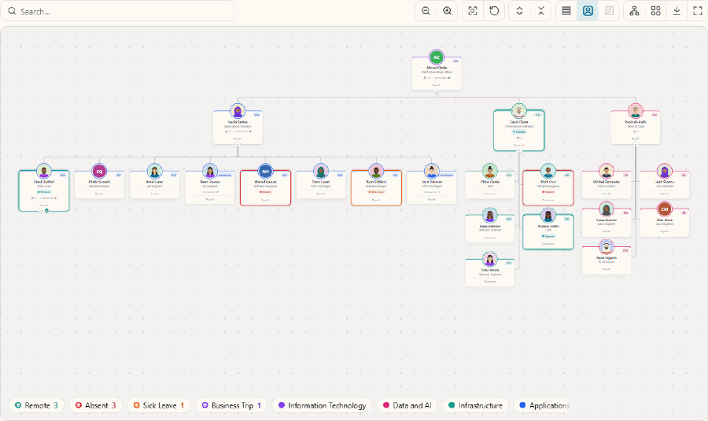
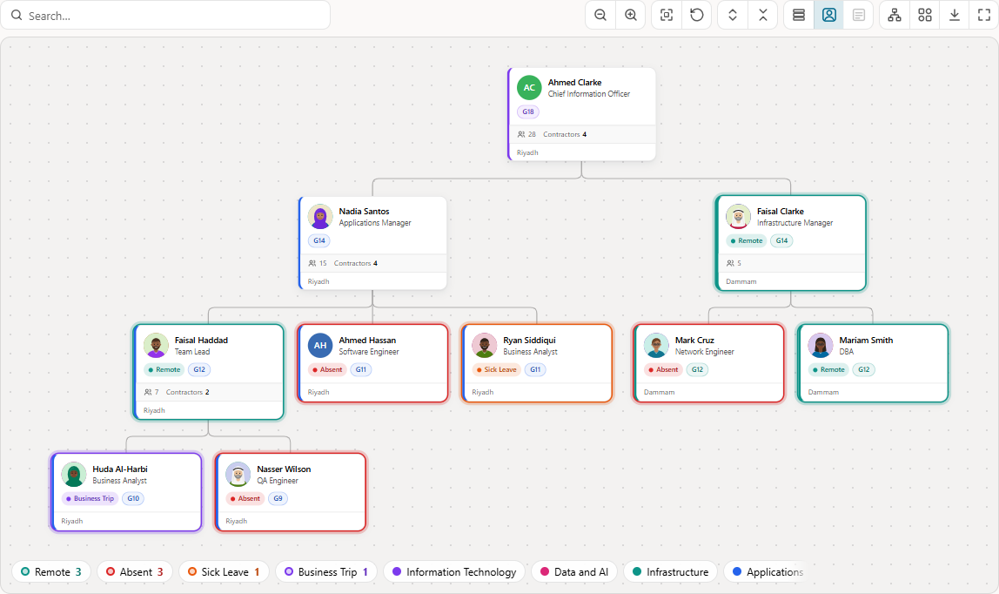
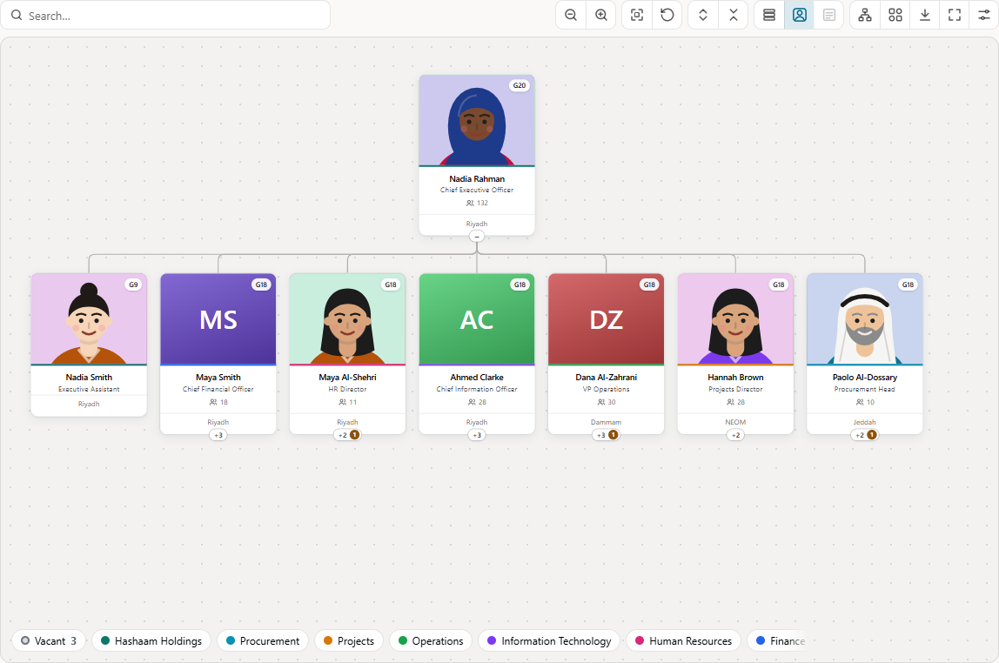
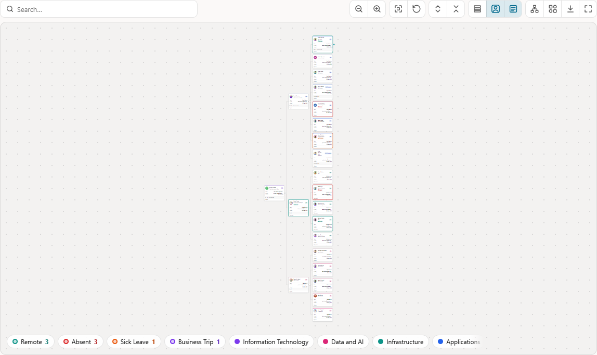
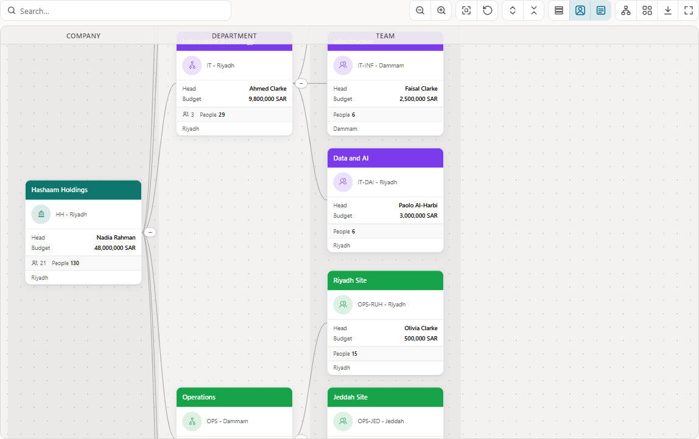

# Hierarchy Pro for Oracle APEX

[](https://apex.oracle.com) [](LICENSE) [](CHANGELOG.md)

A region plug-in that turns any hierarchical SQL query into an interactive chart: org charts, departments, cost centres, bills of material, account trees.



**[Live demo](https://oracleapex.com/ords/r/hashaam-admin/apex-plugins-by-hbs/hierarchy-chart)** (demo / Demo@2026) · [Install](#install) · [First chart in 2 minutes](#your-first-org-chart-in-2-minutes) · [JavaScript API](#javascript-api) · [Changelog](CHANGELOG.md) · [Issues](https://github.com/HashaamShoukat/apex-plugin-hierarchy-pro/issues)

## Features

- **Declarative.** Write any query with your own column names, then pick the columns in Page Designer. Only Node ID, Parent ID (or Level) and Title are required; nothing is guessed from column names.
- **10 views with fixed content**: Avatar Card, Classic Box, Detailed Card, Compact Pill, Bubble, Colored Header, Minimal, Badge Card, Photo Card and a Custom template. Every view shows the title, the team and roll-up totals, and highlighting.
- **One default view, users pick the rest.** You choose the default view and which views users may switch to. Toolbar switches for Compact, Photos and Details.
- **User customization** (optional): a Customize panel where each user changes the view, card content, layout and look, saved in the browser or per user in the database, with *Reset to default*.
- **Highlighting for many nodes at once**, from the data: a status such as *Absent* or *On Leave* gets its colour, a chip, a legend count, a count on closed branches and a **Highlighted Only** view.
- **Links with the Link Builder**, like report column links. Checksums are added; modal pages open as dialogs.
- **Large teams stay readable** (stacked or gridded leaf teams, "+N more" paging) and **big trees stay fast** (1,000 nodes in under 0.1 s; lazy loading for any size).
- **CONNECT BY** queries without a parent column, five orientations including radial, four connector styles, level bands named from the data.
- Search, path highlighting, legend, mini-map, drill into a branch, PNG / SVG / print export, full screen, keyboard and screen-reader support, right-to-left and dark mode (Universal Theme colours), Dynamic Action events and a JavaScript API. UI texts in English and Arabic.

Requires **APEX 24.1 or later** and Oracle Database 19c or later. The layout engine is the plug-in's own (a contour-based tidy tree with variable card heights); it uses a few D3 modules, bundled into the plug-in file, so there are no CDN calls.

| | |
|---|---|
|  |  |
| Badge Card, *Highlighted Only*: who is away in the team | Photo Card with photos from a BLOB column |
|  |  |
| Detailed Card left to right, body and footer columns | A CONNECT BY query, level bands named from the data |

---

## Install

1. **Database objects.** As the application's parsing schema run `@db/install.sql`. It creates the package `HIERARCHY_CHART_PLUGIN_PKG` and the table `HIERARCHY_CHART_PREFS` (each user's saved customization). Safe to run again.
2. **Plug-in.** Shared Components > Plug-ins > Import:
   - `plugin/region_type_plugin_com_hashaam_hierarchy_pro.sql` for APEX 26.1 and later;
   - `plugin/region_type_plugin_com_hashaam_hierarchy_pro_24.1.sql` for APEX 24.1 and 24.2 (the same plug-in without the APEXlang-only names).
3. **Optional translations.** `@db/text_messages_en_ar.sql <app id>` creates the UI texts as text messages `HCP.*` in English and Arabic.

The internal name is `COM.HASHAAM.HIERARCHY_PRO`; the callbacks are `hierarchy_chart_plugin_pkg.render` and `.ajax`. To remove the database objects run `@db/uninstall.sql`.

## Your first org chart in 2 minutes

1. Create a region, **Type** = **Hierarchy Pro**, **Source** = this query:
   ```sql
   select empno, mgr, ename, job, deptno, sal, hiredate
     from emp
   ```
2. In **Attributes > Hierarchy** pick **Node ID** = EMPNO and **Parent ID** = MGR; in **Columns** pick **Title** = ENAME and **Subtitle** = JOB.
3. Run the page. For more, pick **Body Column 1 / 2** = SAL / HIREDATE for the Detailed Card, **Footer Column** = DEPTNO, and set **Behavior > Link** with the Link Builder (e.g. page 2, P2_EMPNO = `#EMPNO#`).

A `CONNECT BY` query needs no parent column: set **Hierarchy Type** = *Level Column* and pick the `LEVEL` column; keep the rows in hierarchical order (`ORDER SIBLINGS BY`).

## Columns

| Setting | Required | What it does |
|---|---|---|
| **Hierarchy** | | |
| Node ID | yes | The node's key; the value `#COLUMN#` links and the JavaScript API use |
| Hierarchy Type, Parent ID / Level | yes | Parent ID: each row names its parent (null = root). Level: a CONNECT BY query. Cycles, orphans, self-parents and duplicate ids are handled with one console warning |
| Level Name Column | | Names the levels from the data (the first value found on each level) and turns the level bands on |
| **Columns** | | |
| Title | yes | Shown by every view, used for initials and search |
| Subtitle | | Second line, e.g. job |
| Color | | The node's accent colour (also its badges) |
| Badge | | A small label; several separated by `;` become chips on the Badge Card |
| Legend | | Groups for a clickable legend |
| Body Column 1 - 4 | | Label / value rows (label = column heading) in the body of Detailed Card and Colored Header |
| Footer Column | | A section of its own at the foot of the card, below the totals (every view except Compact Pill), e.g. the location |
| Roll-up, Roll-up Label | | A number summed up every branch, shown with the team count after its label |
| **Images** | | |
| Icon Column | | Font APEX class, shown by Classic Box and for nodes without a photo |
| Image BLOB Query | | The photos: `select photo, mime from ... where id = :NODE_ID`; loaded lazily, cached for an hour. Nodes with neither photo nor icon show initials |

**Highlighting** has its own two columns: **Highlight Column** (`Y`, or a status such as *Absent*; empty = not highlighted) and **Highlight Color Column** (a colour name - red, orange, amber, yellow, green, teal, cyan, blue, indigo, purple, pink, grey - or any CSS colour). Keep the colours in a lookup table and join it.

Worked out by the plug-in, so there is no column for them: team sizes, child counts (also with lazy loading), branch highlight counts, the hover text (full name, subtitle, status) and the order (the query's ORDER BY).

## Views

| View | Shows besides title, totals and highlighting |
|---|---|
| Compact Pill | photo or initials, badge |
| Avatar Card, Minimal | photo, subtitle, badge, status |
| Bubble, Photo Card | large photo, subtitle, badge, status |
| Classic Box | icon, subtitle, badge, status |
| Badge Card | photo, subtitle, status and every badge as chips |
| Detailed Card, Colored Header | photo, subtitle, badge, status, **body** (Body Columns 1 - 4) |
| Custom Template | your HTML - offered only when a Custom Template is entered. Tokens `&AVATAR.` `&TITLE.` `&SUBTITLE.` `&STATUS.` `&BADGE.` `&FIELDS.` `&TOTALS.` `&FOOTER.` (also `&ICON. &BADGES. &COLOR. &LEVEL. &ID.` and `&ANY_COLUMN.`) |

A sample to start from (also in the attribute's help):

```html
<div class="hcp-tpl">&AVATAR.<div class="hcp-tpl-tx"><div class="hcp-t">&TITLE.</div><div class="hcp-st">&SUBTITLE.</div>&STATUS.</div>&BADGE.</div>&FIELDS.&TOTALS.&FOOTER.
```

Every view except Compact Pill also shows the Footer Column, in its own section below the totals. **Appearance**: *Default View*; *Views Users Can Pick*; *Custom Template*; *Card Content* (subtitle, badge, status, body, footer, totals); *Options*.

## Region settings

| Group | Settings (default) |
|---|---|
| Hierarchy, Columns, Images | see above |
| Appearance | Default View (Avatar Card); Views Users Can Pick (all); Custom Template (empty); Card Content (all); Options (Shadow, Rounded, Photos, Context Menu, Legend, Ctrl + Wheel, Animate; also Compact, Remember State, Lazy Loading, Mini-map, Level Bands, Highlight Whole Branch) |
| Layout | Orientation (Top to Bottom); Connector Style (Rounded Elbow); Leaf Layout (Auto); Node Width (per view); Sibling Gap (24); Level Gap (56) |
| Behavior | Initial Expand Levels (2); Max Children Shown (50); Orphan Nodes (Show as Roots); On Node Click (Auto); Link (Link Builder); Link Attributes (e.g. `target="_blank"`); Click Page Item |
| Highlighting | Highlight Column; Highlight Color Column; Highlight Path (On Click); Path Highlight Color |
| Toolbar & View | Toolbar (Search, Zoom, Fit, Expand / Collapse All, Compact, Photos, Details, Orientation, View, Export, Full Screen; also Highlighted Only); User Customization (No); Height (Fit to Window); Fixed Height (600); Initial View (Fit) |

Standard attributes: Page Items to Submit, No Data Found Message, Initialization JavaScript Function, and column Heading / Escape special characters.

## User customization

Your Page Designer settings are the main configuration everybody starts with. With **User Customization** on, a Customize button opens a panel:

- up front: the view (among *Views Users Can Pick*), card content (subtitle, badge, status, footer, totals, body and which body columns), layout, compact and photos;
- under *More settings*: connectors, teams without reports, card width and spacing, accent and highlight colour, corners, shadows, legend, mini-map and level bands.

Switches the current view has no place for are greyed out. Every change applies at once and is saved in the browser, or per user in `HIERARCHY_CHART_PREFS` (pages without a signed-in user fall back to the browser). Only the settings that differ from yours are stored, and *Reset to default* removes them. The toolbar's Compact / Photos / Details switches and View / Orientation menus save their choice too. JavaScript: `getCustomization()`, `resetCustomization()`, `customize()`; event *Customization Changed*.

## Highlighting many nodes

Highlighting comes from the data. Return a status and its colour - for example who is away today, with the colours in a lookup table:

```sql
select e.emp_id, e.manager_id, e.full_name, e.job_title,
       s.status as day_status, s.color as status_color
  from employees e
  left join attendance a on a.emp_id = e.emp_id and a.att_date = trunc(sysdate)
  left join statuses s   on s.status = a.status and s.status <> 'Present'
 start with e.emp_id = :P10_MANAGER
connect by prior e.emp_id = e.manager_id
```

and pick them as **Highlighting > Highlight Column** and **Highlight Color Column**. Every status shows as a ring and a chip, the legend lists each status with its count (click one to pick those people out), a closed branch shows how many highlighted people it holds, and **Highlighted Only** shows just them and the people above them.

People picked on the page work the same way: return `'Selected'` for them (`case when instr(':' || :P10_FIND || ':', ':' || emp_id || ':') > 0 then 'Selected' end`), submit the item, refresh the region when it changes, and call `statusFilter("Selected")` + `showHighlightedOnly(true)` after the refresh (see *Org Chart with Photos* in the demo app).

## Lazy loading

Tick **Options > Lazy Loading** (needs Hierarchy Type = Parent ID). The first request loads *Initial Expand Levels* levels; each expand sends one filtered query on the region's SQL; children are counted for you so closed nodes show their size; search runs on the server and returns up to 50 matches with their ancestors.

## JavaScript API

```js
const chart = apex.region("orgChart");
chart.refresh();               chart.expandAll();          chart.collapseAll();
chart.expand(id);              chart.collapse(id);         chart.toggle(id);
chart.expandTo(id);            chart.focusNode(id);        chart.drillTo(id);
chart.highlight([id1, id2], true);   chart.clearHighlight();   chart.highlightPath(id);   chart.fitTo([id1, id2]);
chart.showHighlightedOnly(true);     chart.statusFilter("Absent");
chart.setStyle("BADGE");       chart.getViews();           chart.setOrientation("LR");
chart.setOption("compact", true);    // also photos, showSubtitle, showBadge, showStatus, showTotals, showBody,
                                     // showFooter, hiddenFields, connector, leafLayout, nodeWidth, siblingGap, levelGap, accent ...
chart.fit();  chart.zoomIn();  chart.zoomOut();  chart.toggleFullscreen();  chart.search("smith");
chart.exportImage("png");      chart.print();
chart.getNode(id);             chart.getSelection();       chart.select(id);   chart.getData();
chart.customize();             chart.getCustomization();   chart.resetCustomization();
```

Set the region's **Advanced > HTML DOM ID** (26.1) or **Static ID** (24.x) so that `apex.region("...")` finds it. The **Initialization JavaScript Function** receives the options and returns them - e.g. photos that are URLs rather than BLOBs: `function(o){ o.roles.image = "PHOTO_URL"; return o; }`.

## Dynamic Action events

*Node Click*, *Node Double Click*, *Node Expanded*, *Node Collapsed*, *After Render*, *Selection Change*, *Search* and *Customization Changed*. `this.data` holds the node (id, title, subtitle, level, childCount, descendantCount, expanded, and every column in `data`). A modal page opened by the Link fires *Dialog Closed* on the region.

## Keyboard

Arrow keys move to child / parent / sibling (following the orientation, mirrored in RTL); Enter clicks; Space expands / collapses; `*` expands the branch; Home / End; `+` / `-` / `0` zoom and fit; Shift+F10 opens the node menu. The node layer is an ARIA `tree` with a roving tabindex.

## Styling

Colours come from Universal Theme variables, so Theme Roller and dark mode apply. Override on the region, e.g. `.my-chart .hcp { --hcp-hl: #e11d48; --hcp-r: 6px; }`. Main variables: `--hcp-primary`, `--hcp-surface`, `--hcp-text`, `--hcp-muted`, `--hcp-border`, `--hcp-canvas`, `--hcp-link`, `--hcp-hl`, `--hcp-flag`, `--hcp-match`, `--hcp-r`, `--hcp-sh`; each node gets `--hcp-accent` from its Color column.

## Demo application

The **[live demo](https://oracleapex.com/ords/r/hashaam-admin/apex-plugins-by-hbs/hierarchy-chart)** on apex.oracle.com (sign in with **demo / Demo@2026**) is the author's plug-in showcase; its *Hierarchy Pro* menu has:

- **Overview** - Avatar Card, all views, customization in the browser, contractors as roll-up.
- **Org Chart with Photos** - Photo Card from a BLOB column, Link Builder to an employee dialog, customization per user, a multi-select "Find people".
- **Team Attendance** - Badge Card, the day's status and its colour from a lookup table, Highlighted Only; four views only.
- **Style Gallery** - every view, layout, connector, leaf layout and RTL, switched through the JavaScript API.
- **Departments** - a CONNECT BY … LEVEL query, Colored Header left to right, band names from a column, body and footer columns, roll-up.
- **Lazy Loading** - 5,000 nodes from a six-column query, server search, mini-map.
- **How to Use**, **Sample Data**.

`demo/demo.html` runs the chart without APEX on generated data (`demo/mock-data.js`) - open it in a browser.

## Build from source

```
npm install
npm run build        # dist/hierarchyChartPro(.min).js / .css
node qa/custom.js    # views, switches, customization and highlighting on demo/demo.html (needs Chrome)
node qa/perf.js      # layout and render timings
```

Copy `dist/*` into the plug-in's files (`js/`, `css/`) after a build.

```
plugin/   importable plug-in exports (26.1, and 24.1 / 24.2)
db/       hierarchy_chart_plugin_pkg.pks/.pkb, install.sql, uninstall.sql, text_messages_en_ar.sql
src/      js/hierarchyChartPro.js, css/hierarchyChartPro.css (sources)
dist/     built and minified files
demo/     demo.html (runs without APEX), mock-data.js, sample_data.sql
qa/       custom.js, perf.js, shots.js (Playwright checks on the demo page)
tools/    downlevel.mjs (24.1 export), gen-messages.mjs, gen-sample-data.mjs, messages_ar.json, sig/
docs/     images/
```

## Known limitations

- **Lazy loading**: team sizes, roll-ups, status counts and Highlighted Only cover the nodes loaded so far; Expand All opens loaded nodes only; server search matches Title and Subtitle; orphan rows are not loaded.
- **Radial layout**: leaf teams are not stacked or gridded.
- **Link Builder**: each node's URL is prepared on the server (checksum), a little time per row on very large non-lazy charts.
- **Export**: photos from another origin are exported as initials; web fonts are embedded only from the same origin.
- **Compatibility**: built and tested on APEX 26.1; the 24.1 export is checked against the APEX 24.2 import API.

## Support

Questions, bugs and ideas: [GitHub Issues](https://github.com/HashaamShoukat/apex-plugin-hierarchy-pro/issues). Pull requests are welcome.

## Credits and license

Hierarchy Pro is written from scratch - it is not based on another plug-in or blog post. It bundles these [D3](https://d3js.org) modules by Mike Bostock: d3-hierarchy, d3-zoom, d3-selection, d3-transition, d3-drag, d3-dispatch, d3-interpolate, d3-color, d3-timer (ISC) and d3-ease (BSD-3-Clause); see [THIRD-PARTY-NOTICES.md](THIRD-PARTY-NOTICES.md).

[MIT](LICENSE) © 2026 Hashaam Shoukat
